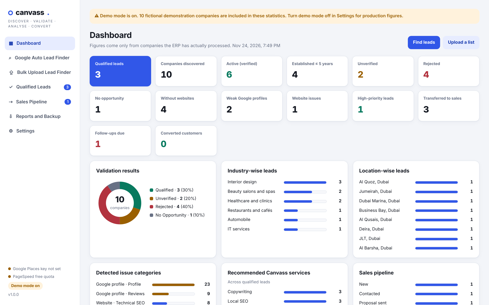

# CANVASS – Intelligent Lead Finder & Business Validation ERP

**Discover. Validate. Analyse. Convert.**

A lead-finding ERP for Canvass. It finds new, active businesses that need website, Google Business Profile, SEO, branding or marketing work. It checks each business against strict rules, audits its online presence, scores the opportunity, recommends Canvass services and drafts a personalized pitch. Only leads that pass every mandatory check reach the sales pipeline.

> **Zero fabricated data.** Every finding stores its source and a timestamp. Missing data is shown as *Not Available*, never as a problem. Age that only rests on domain or archive dates is *Estimated*, not *Verified*.



## Quick start (Windows)

1. Install **Node.js LTS** (version 20 or newer) from <https://nodejs.org>. This is a one-time step.
2. Double-click **`start-canvass.bat`**. Your browser opens at <http://localhost:4321>.
3. In **Settings**, add your Google Places API key. To look around first, use **Load demo data**.

macOS/Linux: run `./start-canvass.sh`. Phones or tablets on the same Wi-Fi: run `start-canvass-network.bat`, which asks you for an access PIN.

There's nothing to `npm install`. The app has no third-party server dependencies. Full guide: [docs/SETUP.md](docs/SETUP.md).

## What is complete, and what needs credentials

| Feature | Status |
|---|---|
| Dashboard with 14 live statistics and 6 charts, all from processed data | ✅ Complete |
| Module A: Google Auto Lead Finder (country, city, area, industry, category, number of leads) | ✅ Complete. **Needs a Google Places API key** (billing enabled) |
| Module B: Bulk Upload (Excel, CSV, URLs, company names, Google Maps links) | ✅ Complete. Google checks need the key; website and age checks work without it |
| Active-business verification (Google status, recent reviews, working website, hours, phone, map location, team evidence) | ✅ Complete |
| Company and website age (documented licence date, RDAP domain records, Internet Archive, dated reviews) | ✅ Complete. No paid registry API is connected. Licence dates are added by the team or in the upload |
| Google Business Profile audit (location, profile, photos, reviews, local SEO) with industry benchmarks | ✅ Complete. Needs the Places key |
| Review analysis (themes, repeated complaints, confidence, authenticity note) | ✅ Complete. Limited to the ≤5 reviews the API returns |
| Website audit (availability, HTTPS, mobile, SEO metadata, broken links, enquiry form, WhatsApp, CTAs, local SEO, AEO, content, e-commerce, maintenance) | ✅ Complete. Measured live |
| PageSpeed Insights scores | ✅ Complete. The free quota is shared and often exhausted, so a free PageSpeed key is recommended |
| Four validation categories plus duplicates, with mandatory rules overriding the score | ✅ Complete |
| Configurable 100-point lead score with High/Medium/Low priority | ✅ Complete |
| Service recommendations (34 Canvass services, each switchable) | ✅ Complete |
| Pitch generator: email, WhatsApp, call script, proposal, free-audit offer | ✅ Complete. Built from real findings only |
| Automatic **sending** of emails or WhatsApp messages | ❌ Not built. Needs an authorised email/WhatsApp Business integration and consent handling. Pitches are copied and sent by your team, then logged; repeat-message protection is built in |
| Sales pipeline (7 stages, assignee, follow-ups, notes, history, contact log, do-not-contact) | ✅ Complete |
| Duplicate detection (Place ID, domain, phone, name and location, name and domain) | ✅ Complete |
| Backups (daily automatic, manual, download, restore), search history, audit history, API usage and cost | ✅ Complete |
| Excel and CSV import/export | ✅ Complete |
| Google Maps Platform compliance (30-day cache purge, attribution, Google content excluded from exports by default) | ✅ Complete |
| **Free-tier protection**: hard monthly and daily limits on Google Places requests, enforced before a request is sent | ✅ Complete (on by default: 500 per month, 100 per day) |
| Scheduled discovery (daily, weekly or monthly) | ✅ Complete. Runs while the app is running |
| Team logins and multi-office cloud sync | ❌ Not built. The app is a local single-office server by design ("no login for local use"). Network mode with a PIN lets several devices on the same Wi-Fi share one database |
| Android | ⚠️ Installable web app (PWA). Full install needs HTTPS; over plain Wi-Fi it opens in the browser. No native APK |
| Windows installer | ⚠️ A startup launcher (`start-canvass.bat`), not an MSI installer. Node.js must be installed once |
| Video training | ❌ Not produced. The PDF manual and PowerPoint deck include real screenshots instead |

## The validation rules (summary)

A company is **Qualified** only if **all** of these pass:

- Not a duplicate.
- Currently operating. Needs Google "operational" status **and** recent activity (a review within 12 months, a working website, or team-verified activity) **and** at least 2 activity signals. A Maps listing alone never counts.
- Genuine business (a Google listing or team confirmation).
- In the selected industry and location.
- Small or growing (not over 1,000 reviews, not a chain of 3 or more same-name locations).
- Established within the last **5 years**. The window rolls forward from today's date. Verification comes from a documented licence or registration date. A dated review older than the window rejects the company. Domain and archive dates are only supporting evidence.
- Has public contact information.
- Has at least one **confirmed** digital issue.

When something fails, the company goes to **Rejected** (for example: old, closed, large, out of area, wrong industry, invalid or duplicate). When something can't be confirmed, it goes to **Unverified**. An eligible company with nothing to fix goes to **No Opportunity**. A high score can never override a failed rule. All thresholds are adjustable in Settings.

## Project layout

```
server/            Node.js backend (no dependencies)
  index.js         Web server + REST API
  lib/places.js    Google Places API (New) client
  lib/verify.js    Age, activity, industry, location, size checks
  lib/website-audit.js   Website audit + PageSpeed
  lib/gbp-audit.js       Google Business Profile audit + review analysis
  lib/scoring.js   Validation categories, lead score, service mapping
  lib/pitch.js     Pitch generator
  lib/engine.js    Discovery, bulk processing, jobs, scheduler
  lib/db.js        Local JSON database, backups, retention purge
public/            Web interface (HTML, CSS, JS, PWA files, SheetJS)
test/              Automated tests (node --test)
docs/              Setup guide, API docs, manual (PDF), training deck, test report
samples/           Labelled demo upload template
legacy/            Previous version of the app and its 102-business list (kept for reference)
data/              Your database and backups (created on first run; never committed)
```

## Documentation

- [Setup and installation](docs/SETUP.md)
- [API configuration (Google keys)](docs/API-CONFIGURATION.md)
- [REST API reference](docs/API.md)
- [User manual (PDF)](docs/Canvass-User-Manual.pdf)
- [Training presentation (PowerPoint)](docs/Canvass-Training.pptx)
- [Validation test report](docs/TEST-REPORT.md)

## Tests

```bash
npm test
```

Runs 65 automated checks covering mandatory rules, duplicate detection, API failures, missing-information handling, pipeline transfer, free-tier limits, retention purge, backups and API security.

## Data and privacy

- `data/` holds business contact details and is excluded from Git. Back it up with **Reports and Backup**.
- API keys stay on the server. They are masked in the browser and never included in backup downloads.
- The previous app's README mentioned an exposed PageSpeed key. Rotate that key in Google Cloud before using it here.
