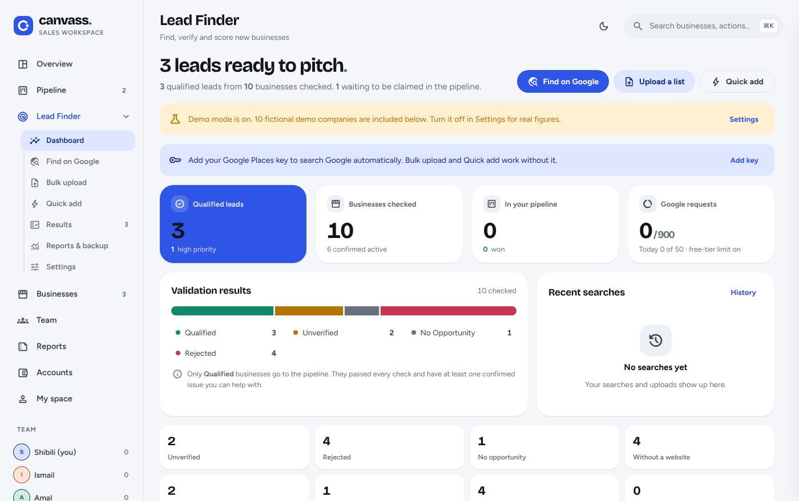

# Canvass

**One app for the whole team: Pitch HQ + Lead Finder, with one login.**

- **Pitch HQ** is the sales workspace: Overview, Pipeline (Spotted → Claimed → Building pitch → Pitched → Follow-up → Won), Businesses, Team, Reports, Accounts and My space.
- **Lead Finder** is a tool inside it. It finds new businesses (on Google, from a list, or one at a time), checks each one against strict rules, audits its Google profile and website, scores the opportunity and drafts pitches. Businesses that pass every check join the pipeline under **Spotted**.

> **Zero fabricated data.** Every finding keeps its source and a timestamp. Missing data shows as *Not Available*, never as a problem. Age that rests only on domain or archive dates is *Estimated*, not *Verified*.



## Try it on your computer

Download **Canvass-Local.zip** (from the release, or build it with `scripts/package-local.sh`), unzip it and:

- **Windows:** double-click **Start Canvass.bat**. PHP is included; nothing to install.
- **Mac:** install PHP once (`brew install php`), then double-click **Start Canvass (Mac).command**.

Your browser opens <http://localhost:4400>. First sign-in: **MSB / admin** (change it in *My space*). Everything you add is saved in the `data` folder next to the app. Full guide: [docs/SETUP.md](docs/SETUP.md).

## Put it online (Hostinger Premium Web Hosting)

The app is plain **PHP 8.2 + SQLite**, the same as Pitch HQ, so it runs on the current plan. Upload the contents of the `canvass/` folder, add one cron job, and sign in. Step by step: [docs/SETUP.md](docs/SETUP.md#put-it-online-hostinger).

## What's in the box

| Area | What it does |
|---|---|
| Sidebar | Lead Finder has its own menu that opens under it and folds away. On phones it becomes a **Finder** tab with buttons at the top of each Lead Finder page |
| Find on Google | Country, city, area, industry, business type and number of leads. Google Places API (New) |
| Bulk upload | Excel, CSV, or pasted websites, names and Google Maps links |
| Quick add | Paste one Google Maps listing (with the one-click grabber), score it, save it, optionally run every check on it |
| Checks | Open now, genuine, industry, area, size, age within 5 years (rolling), contact details, at least one confirmed issue |
| Audits | Google Business Profile, customer reviews, website (HTTPS, mobile, SEO, enquiry paths, WhatsApp, local SEO, AEO, broken links, PageSpeed) |
| Results | Qualified, Unverified, No opportunity, Rejected, Duplicates skipped, with a 100-point lead score that never overrides a failed rule |
| Pitches | Email, WhatsApp, call script, proposal, audit offer, from real findings only, never sent automatically; 14-day repeat warning and do-not-contact |
| Pipeline hand-off | Qualified leads become pipeline cards (unclaimed, in Spotted) with the findings in the notes and a link to the full report |
| Free-tier protection | Every Google Places request is counted per Pacific-Time month and day and refused **before sending** past the limits (default 900 a month, 50 a day) |
| Google terms | Google content deleted after 30 days (Place ID kept), left out of exports by default, never copied into the pipeline |
| Reports and backup | Excel and CSV export, daily backups, restore, search history, Google usage. **v1.0 (Windows) backups import here** |
| Accounts | Capital, expenses, income and recurring bills behind a separate accounts password |
| Security | Sign-in with hashed passwords, login attempt limits, app-only request header, private data folder, keys masked and never in backups |

## For developers

```
canvass/                 the web app (upload this folder's contents)
  index.html             Canvass shell (Pitch HQ screens)
  lf.js, lf.css          Lead Finder screens
  api.php                web API: Pitch HQ, Accounts, Lead Finder (lf_* actions)
  cron.php               background worker (searches, schedules, backups, Google purge)
  router.php             local test server rules (php -S)
  lib/core.php           data folder, SQLite, sessions
  lib/lf/                Lead Finder engine (ported rule for rule from v1.0)
  tests/                 75 tests:  php canvass/tests/run.php
scripts/package-local.sh builds dist/Canvass-Local.zip (PHP for Windows included)
server/, public/, test/  v1.0 Windows app (Node.js), kept until Canvass 2.0 replaces it
```

Run the tests with `php canvass/tests/run.php`. They cover the validation rules, audits, free-tier limits, the engine with a mocked Google API, and the web API on a real local server. API reference: [docs/API.md](docs/API.md). Google keys: [docs/API-CONFIGURATION.md](docs/API-CONFIGURATION.md). Results: [docs/TEST-REPORT.md](docs/TEST-REPORT.md).
